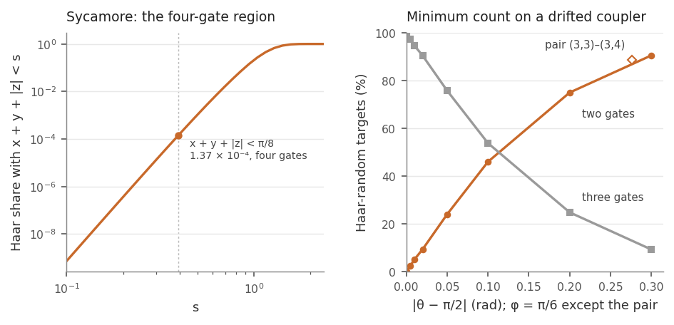
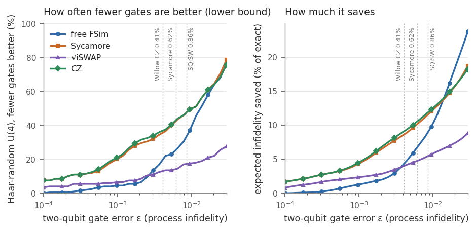
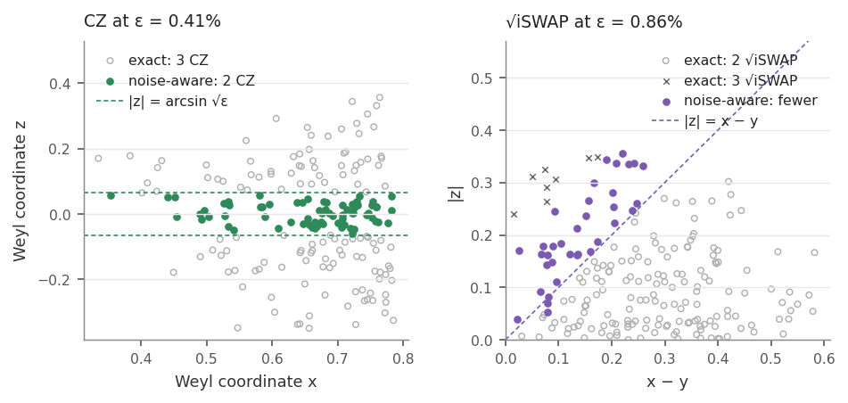

# cirq-fsim-compiler

Decompose two-qubit gates into FSim interactions and compile circuits for tunable-coupler hardware.

[](https://github.com/Jaspersands/cirq-fsim-compiler/actions/workflows/ci.yml)
[](LICENSE)

Superconducting processors with tunable couplers implement the fermionic-simulation gate FSim(θ, φ) (Foxen et al. 2020). This package finds decompositions of any two-qubit unitary into FSim gates and single-qubit rotations by numerical optimisation. The FSim angles can be free, or fixed to the one gate a calibrated coupler performs: Sycamore's FSim(π/2, π/6), √iSWAP, or CZ = FSim(0, π), the native gate on Google's Willow and on neutral-atom processors (Evered et al. 2023). As a Cirq transformer it compiles whole circuits, merges runs of gates on the same qubit pair, routes onto a coupling graph, and reads and writes OpenQASM 3.

Version 0.5 adds a comparison with Cirq's own decompositions, finds the exact minimum gate count for any fixed FSim before searching (from the Weyl chamber and the monodromy polytope), and adds a noise-aware mode that uses fewer gates when the approximation error is smaller than the error of the gates it saves.

[Interactive page](https://fsim.jaspersands.com/): the decomposition in the browser, with synthesis in a background worker and OpenQASM export of the fitted angles.

## Why numerical synthesis

Cirq already decomposes any two-qubit unitary into CZ or √iSWAP gates in closed form. Those routines are exact, reach the minimum gate count and take one or two milliseconds. On those two gate sets this package gives the same counts and is slower: in the benchmark below the median is 7.8 against 1.4 ms per target for CZ and 11 against 0.7 ms for √iSWAP. Numerical synthesis is useful where a closed form is missing or not wanted:

- a calibrated gate that is neither CZ nor √iSWAP, such as Sycamore's FSim(π/2, π/6) or a coupler whose angles have drifted;
- merged blocks on such a gate: a run of gates on one qubit pair then costs what its class costs on that gate;
- a deliberately approximate decomposition with fewer gates.

## The decomposition

A target $U_t$ is approximated by

$$U(p) = L_n\,\mathrm{FSim}(\theta_n,\varphi_n)\cdots \mathrm{FSim}(\theta_1,\varphi_1)\,L_0,\qquad L_k = R_k\otimes R'_k,\quad R = R_z R_x R_z,$$

minimising $1 - |\mathrm{Tr}(U_t^\dagger U)|^2/16$ for increasing $n$ (up to 4 by default) and keeping the smallest $n$ that meets the tolerance.

- With free angles, every standard gate (CNOT, CZ, iSWAP, √iSWAP, SWAP) takes one FSim, and a Haar-random unitary takes two.
- With a calibrated coupler only the single-qubit layers are optimised. On Sycamore's FSim(π/2, π/6), CZ takes two gates and SWAP or a random unitary takes three; the weakly entangling classes with z ≠ 0 and x + y + |z| < π/8, 1.4 in 10⁴ of the Haar measure, take four (next section). On √iSWAP, iSWAP takes two. On CZ, SWAP takes three, and so does a random unitary.
- There are two solvers for the same loss: L-BFGS-B on Euler angles with JAX gradients, and Riemannian descent that keeps every single-qubit layer exactly unitary through Cayley retractions. They agree to $10^{-8}$.
- The stage search starts at the minimum count read from the target's Weyl coordinates (next section) instead of at one. That count is exact for every native gate, so if the search fails there it retries once with three times the restarts and five times the iterations.
- Two analytic routes from Cirq are tried where they apply. For a controlled-phase class (Weyl y = z = 0), `cirq.decompose_cphase_into_two_fsim` is tried at two gates after a KAK change of basis, on every calibration, √iSWAP and drifted couplers included; Cirq's routine decides whether the native gate can make the controlled phase, and where it returns a circuit the circuit is exact. At four gates, `cirq.decompose_two_qubit_interaction_into_four_fsim_gates` is the fallback when the search fails.
- If the result still misses the tolerance, the synthesiser and the transformer issue a `SynthesisWarning` that says the output is not equivalent to the target. With `on_failure="raise"` they raise `SynthesisError` instead.

## The Weyl chamber

Every two-qubit gate is $k_1 \exp(i(x\,XX + y\,YY + z\,ZZ))\,k_2$ with single-qubit layers $k_1, k_2$ (Zhang et al. 2003). The coordinates, canonicalised to $\pi/4 \ge x \ge y \ge |z|$ with $z \ge 0$ when $x = \pi/4$, label the gate up to single-qubit gates. The count functions accept a unitary or any coordinate 3-vector, which they canonicalise first. The module `weyl` reads them from `cirq.kak_decomposition(u).interaction_coefficients`. FSim(θ, φ) sits at the class of $(-\theta/2, -\theta/2, -\varphi/4)$.

Minimum native-gate counts in closed form:

| native gate | 0 | 1 | 2 | 3 |
|---|---|---|---|---|
| CZ (or CNOT) | local | (π/4, 0, 0) | z = 0 | otherwise |
| √iSWAP | local | (π/8, π/8, 0) | x − y ≥ \|z\| | otherwise |
| free FSim | local | x = y or y = \|z\| | otherwise | never needed |

The CZ rule is the standard CNOT-count result (Vidal and Dawson 2004; Shende, Markov and Bullock 2004) and agrees with `cirq.num_cnots_required`. The √iSWAP rule is from Huang et al. 2023, where the two-gate region holds 79% of the Haar measure. The free-FSim rule follows from the FSim coordinates for one gate. Two gates always suffice because conjugating the second FSim by H⊗H swaps its XX and ZZ terms, and the two interaction vectors then add to any (x, y, z). The tests check the CZ and √iSWAP rules against Cirq, and the √iSWAP and free-FSim rules against multi-start synthesis, including points on the boundary x − y = |z|, where two √iSWAP still suffice.

For any other fixed FSim the count comes from the exact n-gate regions in the next subsection. For Sycamore and other controlled-phase-type gates, three facts also bound it by hand:

- One gate reaches only its own class, and the best fidelity with zero or one gate has a closed form (`class_fidelity`).
- Two controlled-phase gates FSim(0, φ), or two gates FSim(π/2, φ), reach only the face z = 0. FSim(π/2, φ) is SWAP times a controlled phase, and SWAP² = 1, so two such gates act like two controlled phases. For those tr γ(U) is real, which is the Shende–Markov–Bullock condition for two CNOTs.
- Controlled-phase strengths add. For |φ| ≤ π, FSim(0, φ) has strength s = |φ|/4, and FSim(π/2, φ) carries a controlled phase of strength s = π/4 − |φ|/4 besides the SWAP (5π/24 for Sycamore). n controlled phases, with any single-qubit gates between them, reach only x + y + |z| ≤ n·s. With an odd number of FSim(π/2, φ) a SWAP is left over, and then x + y + |z| ≥ 3π/4 − n·s. The proof goes through the magic-basis spectrum and Thompson's theorem $e^{iA}e^{iB} = e^{i(VAV^\dagger + WBW^\dagger)}$ (Thompson 1986). The tests check both inequalities on random products.

For Sycamore this gives two consequences. Two gates reach only z = 0 with x + y ≤ 5π/12, which excludes iSWAP, so iSWAP needs three. Three gates need x + y + |z| ≥ π/8 ≈ 0.39, so every class with z ≠ 0 and x + y + |z| < π/8 needs four. An example is exp(i(0.1 XX + 0.05 YY + 0.02 ZZ)), whose best three-gate fit has process infidelity 1.6e-2. The bound is tight. Three controlled phases of strength 5π/24 on XX, YY and ZZ give (5π/24)(1, 1, 1), the leftover SWAP maps that to (π/24, π/24, π/24), where the sum is exactly π/8, and the synthesiser reaches that class with three gates (a test checks this). The exact regions below show that no class farther out needs four.

### Exact regions from the monodromy polytope

Peterson, Crooks and Smith (2020) give the condition for a class C to be A·k·B, with A and B fixed and k some layer of single-qubit gates: linear inequalities in the monodromy coordinates of A, B and C (the eigenvalue phases of U (Y⊗Y) Uᵀ (Y⊗Y)), one for each nonzero quantum Littlewood–Richardson coefficient of the Grassmannians Gr(r, 4). The module `monodromy` chains this condition. A target is made by n copies of a native gate exactly when there are n − 2 intermediate classes with every step inside the polytope. Each step lies in one of two convex pieces, so the question is 2ⁿ⁻¹ small linear programs in the intermediate coordinates, which scipy solves. For FSim(0, φ) and FSim(π/2, φ) the regions also have a closed form, which Peterson, Bishop and Javadi-Abhari (2022) derive from the same polytope: n controlled phases of strength s reach x + y + |z| ≤ n·s, −x + y + |z| ≤ (n − 2)·s and |z| ≤ (n − 2)·s, and an odd number of FSim(π/2, φ) leaves a SWAP, which maps (x, y, |z|) to (π/4 − |z|, π/4 − y, π/4 − x). The package uses the closed form for those gates and the linear programs for every other fixed FSim.

Peterson's `monodromy` package implements the polytope with exact rational arithmetic, but it needs the `lrs` program (GPLv2) and is not on PyPI, so this package does not depend on it. The table of 44 coefficients is copied from it (Apache-2.0). The linear programs work in floating point, so a target within about the tolerance of a region's boundary can land on either side, as with the closed forms above.

The tests check the regions against independent results:

- They reproduce the CZ rule (z = 0) and the √iSWAP rule (x − y ≥ |z|) on random classes and on the face z = 0.
- The closed form and the linear programs agree on five controlled-phase-type gates, for two to four gates.
- For four generic gates (a drifted Sycamore, the calibrated pair below, FSim(1, 0.4) and FSim(0.6, −1.1)), multi-start synthesis reaches the count the polytope gives and stays above 1e-6 with one gate fewer. The benchmark below repeats this on 10 targets for each of nine native gates, with the same result for all 90.
- `cirq.decompose_cphase_into_two_fsim` succeeds on three generic gates exactly for the controlled phases CPhase(kπ/8) that the two-gate region contains.
- FSim(1, 0.4) and its mirror image FSim(1, −0.4) have different regions, and synthesis agrees with the right one.

On Sycamore, s = 5π/24. With the SWAP map, the three inequalities for three gates become x + y + |z| ≥ π/8, x + y − |z| ≥ π/24 and x ≥ π/24. The last two follow from the first, because y and |z| are at most x. So three gates reach exactly the classes with x + y + |z| ≥ π/8, and four reach everything:

| minimum Sycamore count | classes | Haar measure |
|---|---|---|
| 0 | local | 0 |
| 1 | (π/4, π/4, π/24) | 0 |
| 2 | z = 0 and x + y ≤ 5π/12 | 0 |
| 3 | every other class with x + y + \|z\| ≥ π/8 | 1 − 1.3746 × 10⁻⁴ |
| 4 | z ≠ 0 and x + y + \|z\| < π/8 | 1.3746 × 10⁻⁴, about 1 in 7,300 |

The Haar measure is the integral of the Haar density on the Weyl chamber, |Π sin 2(cᵢ + cⱼ) sin 2(cᵢ − cⱼ)| (Watts, O'Connor and Vala 2013), over the region. The same density gives 79.01% for the √iSWAP two-gate region, the figure of Huang et al., and 4 × 10⁶ Haar-random unitaries give 1.39 ± 0.06 × 10⁻⁴ for the four-gate region. Cirq's four-FSim routine uses four gates for every target, and that four is a guarantee. This package uses three on all but that region, and three is the minimum there.



A drifted coupler is a generic FSim and has none of this structure. FSim(π/2 + δ, φ) and FSim(π/2 − δ, φ) are the same class, so only |δ| matters, and a drift in φ alone leaves the gate a SWAP times a controlled phase. A drift in θ gives the two-gate region volume. Shares of 2,000 Haar-random targets by minimum count, with φ = π/6 (standard error at most 1.1 points):

| \|θ − π/2\| | two gates | three gates | four gates |
|---|---|---|---|
| 0 (Sycamore) | 0 | 99.95% | 0.05% |
| 0.005 | 2.55% | 97.4% | 0.05% |
| 0.01 | 5.2% | 94.75% | 0.05% |
| 0.02 | 9.45% | 90.55% | 0 |
| 0.05 | 24.1% | 75.9% | 0 |
| 0.1 | 46.1% | 53.9% | 0 |
| 0.2 | 75.1% | 24.9% | 0 |
| 0.3 | 90.65% | 9.35% | 0 |

The four-gate entries are one target, the same in each row. Its class is (0.189, 0.177, 0.026), where x + y + |z| is 5 × 10⁻⁴ below π/8. The exact Sycamore share is 0.014%, so one in 2,000 is within chance. Synthesis agrees with the polytope on 10 targets in each row.

On FSim(π/2 + 0.02, π/6 − 0.01) the class (0.1, 0.05, 0.02), which needs four Sycamore gates, needs two, while (0.01, 0.005, 0.002) needs four; synthesis confirms both. Pooled over 20 couplers drawn with the default drift of `SycamoreCalibrationMap` (σθ = 0.02, σφ = 0.015), 6.3% of the targets need two gates, 93.65% three and one four. The 20 couplers have |θ − π/2| of 0.013 on average and 0.054 at most.

The per-pair angles of the supremacy experiment (Arute et al. 2019) are published inside the released circuit files on Dryad, where each pair's calibrated FSim(θ, φ) replaces the nominal π/2 and π/6. Kalai, Rinott and Shoham (2022) quote one of them: θ = 1.2947 and φ = 0.4859 for the pair (3,3)–(3,4). With that gate 88.8% of Haar-random targets need only two gates and the rest three, while CPhase(π/8) and CPhase(π/4) need three. This package does not compile against the full set: the angles of every pair would have to be read from the circuit archives (27 MB and more), which it does not download.

`minimum_count` reads the count off these regions and says how it is known: "closed form" for CZ, √iSWAP, free angles and counts of zero or one, "proven" for counts from the regions. With `method="search"` it runs the multi-start search of earlier versions instead, upward from the lower bounds above, and says "numerical" when the search ends above every bound it can prove by hand.

`predict_stages` combines these into the count where the search starts. On the benchmark below this skips the failing attempts at one stage (free angles) or at one and two stages (CZ, Sycamore). In that run the total time dropped by a factor of 2.7 to 6.7; the factor depends on the targets and on the machine's load, and other runs (the notebook's, for example) give other values.

| gate set | median ms without pruning | median ms with pruning | speed-up (total time) |
|---|---|---|---|
| free FSim | 29 | 6.4 | 4.4× |
| Sycamore | 58 | 8.3 | 6.7× |
| √iSWAP | 41 | 11 | 2.7× |
| CZ | 55 | 7.8 | 6.7× |

Without pruning, the plain search from n = 1 found the minimum count for 99.5% of free-angle targets and 99.1% of √iSWAP targets; with pruning and the retry it found all of them.

## Against Cirq's built-in decompositions

`benchmarks/compare_with_cirq.py` runs the comparison. It writes the tables to [`benchmarks/results/compare_with_cirq.md`](benchmarks/results/compare_with_cirq.md) and compact results (summaries, timing arrays, the noise-aware study) to `compare_with_cirq.json`. The full output with every row goes to `benchmarks/results/full/`, which is not committed. `cirq-fsim compare` runs the same comparison and prints the tables; with `--out FILE` it also writes the full results as JSON. The library function is `cirq_fsim_compiler.compare.run_comparison`. The baselines are the closest Cirq built-ins:

- CZ: `cirq.two_qubit_matrix_to_cz_operations` (full CZs only).
- √iSWAP: `cirq.two_qubit_matrix_to_sqrt_iswap_operations`.
- Sycamore: `cirq_google.SycamoreTargetGateset` is the main baseline, given the named gate where there is one (it has special cases for SWAP and iSWAP). The cirq-core baseline uses no gate for a local target, `cirq.decompose_cphase_into_two_fsim` after a KAK change of basis for every controlled-phase class (Weyl y = z = 0, so CNOT takes two), and `cirq.decompose_two_qubit_interaction_into_four_fsim_gates` for everything else.
- Free FSim: the shortest of `two_qubit_matrix_to_cz_operations` with full CZs, the same with partial CZs (`allow_partial_czs=True`; a partial CZ is FSim(0, φ), so this already uses free angles within the controlled-phase family), and the √iSWAP routine.

All timings are the best of three calls after warm-up, for this package and for Cirq alike.

The targets are CNOT, CZ, iSWAP, √iSWAP, SWAP, CPhase(kπ/8) for k = 1 to 7, and 200 Haar-random unitaries (seed 2026). Two-qubit gate counts, as the mean over each group, with the minimum in brackets:

| target | free FSim: ours / Cirq | Sycamore: ours / cirq_google / Cirq core | √iSWAP: ours / Cirq | CZ: ours / Cirq |
|---|---|---|---|---|
| CNOT | 1 / 1 [1] | 2 / 2 / 2 [2] | 2 / 2 [2] | 1 / 1 [1] |
| CZ | 1 / 1 [1] | 2 / 2 / 2 [2] | 2 / 2 [2] | 1 / 1 [1] |
| iSWAP | 1 / 2 [1] | 3 / 3 / 4 [3] | 2 / 2 [2] | 2 / 2 [2] |
| √iSWAP | 1 / 1 [1] | 2 / 4 / 4 [2] | 1 / 1 [1] | 2 / 2 [2] |
| SWAP | 1 / 3 [1] | 3 / 3 / 4 [3] | 3 / 3 [3] | 3 / 3 [3] |
| CPhase(kπ/8) | 1 / 1 [1] | 2 / 2 / 2 [2] | 2 / 2 [2] | 2 / 2 [2] |
| Haar-random U(4) | 2 / 2.21 [2] | 3 / 6 / 4 [3] | 2.21 / 2.21 [2.21] | 3 / 3 [3] |

`cirq_google` decomposes a generic target through CZ, two Sycamore gates per CZ, hence six. Accuracy and speed over all 212 targets of each gate set:

| gate set | at the minimum | minimum known by | max process infidelity, ours / Cirq | median ms, ours / Cirq |
|---|---|---|---|---|
| free FSim | 100% | closed form | 9e-15 / 1e-15 | 6.4 / 3.6 |
| Sycamore | 100% | exact regions | 9e-15 / 2e-15 | 8.3 / 7.9 (cirq_google), 2.7 (core) |
| √iSWAP | 100% | closed form | 1e-12 / 2e-15 | 11 / 0.7 |
| CZ | 100% | closed form | 6e-15 / 1e-15 | 7.8 / 1.4 |

Whole circuits go through `cirq.optimize_for_target_gateset` with `CZTargetGateset`, `SqrtIswapTargetGateset` or `cirq_google.SycamoreTargetGateset`. For the cirq-core Sycamore baseline the circuit is merged into two-qubit blocks with `cirq.merge_k_qubit_unitaries` and each block goes through the rule above. All compilations assume all-to-all connectivity, and every compiled circuit, this package's in exact mode included, is equivalent to its input: the worst process infidelity is 1.6e-10, and a test checks every suite circuit in exact mode on all four gate sets. Two-qubit gate counts:

| circuit | CZ: Cirq / ours | √iSWAP: Cirq / ours | Sycamore: cirq_google / Cirq core / ours |
|---|---|---|---|
| Toffoli | 6 / 6 | 10 / 10 | 10 / 10 / 10 |
| Fredkin | 7 / 7 | 12 / 12 | 12 / 12 / 12 |
| CCZ | 6 / 6 | 10 / 10 | 10 / 10 / 10 |
| QFT3 | 9 / 9 | 9 / 9 | 9 / 10 / 9 |
| QFT4 | 18 / 18 | 18 / 18 | 18 / 20 / 18 |
| Cuccaro adder (4q) | 21 / 21 | 42 / 42 | 42 / 42 / 42 |
| GHZ (4q) | 3 / 3 | 6 / 6 | 6 / 6 / 6 |
| random 3q #1 | 9 / 9 | 10 / 10 | 13 / 14 / 11 |
| random 3q #2 | 10 / 10 | 11 / 11 | 16 / 16 / 13 |
| random 4q #1 | 18 / 18 | 16 / 16 | 34 / 26 / 21 |
| random 4q #2 | 19 / 19 | 15 / 15 | 32 / 26 / 19 |
| total | 126 / 126 | 159 / 159 | 202 / 192 / 171 |

With a per-gate error ε (below), the estimated circuit fidelity F·(1 − ε)ⁿ on Sycamore averages 0.909 for this package, against 0.894 for `cirq_google` and 0.899 for the cirq-core baseline. On CZ and √iSWAP the estimates are equal. The fidelity table, with the noise-aware columns, is in the results file.

Where this package does better:

- Arbitrary calibrated angles. On Sycamore's gate a generic two-qubit unitary takes three gates, against four from the cirq-core routine and six from `cirq_google`. On the named gates `cirq_google` matches this package except on √iSWAP (four against two). A drifted coupler is handled the same way, with no closed form needed.
- Consolidation on a calibrated gate. On Sycamore the circuit suite takes 171 gates, against 202 from `cirq_google` and 192 from the cirq-core baseline. The difference comes from the four random circuits, whose merged blocks are generic; on the other seven circuits the counts are equal or the cirq-core baseline is one or two higher. On CZ and √iSWAP, `optimize_for_target_gateset` merges blocks too, and the counts are equal.
- Approximation chosen from ε. Cirq's closest counterpart is the Sycamore tabulation route, compared in the next section.

Where it does worse:

- Speed. Per two-qubit target, Cirq's analytic routines take 0.7 to 3.6 ms (median by gate set) and this package 6.4 to 11 ms; `cirq_google` takes 7.9 ms. For whole circuits the medians are 20 to 27 ms in exact mode and 35 to 83 ms in noise-aware mode, against 13 to 15 ms for Cirq and 20 ms for `cirq_google`.
- Guarantees on Sycamore. Cirq's four-FSim routine uses four gates for every target, and that is guaranteed. This package's count is the proven minimum, but the decomposition at that count is found by search. The search has the four-FSim routine as a fallback at four gates, and a result that misses the tolerance issues a `SynthesisWarning` (or raises `SynthesisError` with `on_failure="raise"`); none did in this benchmark.
- Exactness. Results are converged to a tolerance (here 1e-9; the worst case reached 1e-12), not to machine precision.
- On CZ and √iSWAP there is no count advantage.

## Noise-aware synthesis

An exact decomposition is not the most accurate circuit when every native gate has an error. If each two-qubit gate adds process infidelity ε and the best fit with n gates has process fidelity F(n), the expected infidelity is about

$$C(n) = (1 - F(n)) + n\,\varepsilon .$$

With `approximation="noise_aware"` the synthesiser fits every n below the exact count and returns the n with the smallest C(n). The exact decomposition is always a candidate, so the returned C(n) is never higher than the exact one; that holds by construction and says nothing about how good the fits are. Zero gates and one copy of a fixed native gate have closed-form best fidelities. For one free FSim the class fidelity is closed form and is maximised over (θ, φ) on a grid followed by Nelder–Mead. Other counts are fitted by multi-start search with 16 restarts of up to 500 iterations. A numerical fit is an upper bound on the best infidelity, so the fractions below are lower bounds on how often fewer gates are better. The same option on the transformer applies the rule to each merged block and records each block's approximation infidelity $e_i$. `infidelity_bound()` returns $\sin^2(\sum_i \arcsin\sqrt{e_i})$, a bound on the whole circuit's approximation error from the triangle inequality for the angle between Choi states.

ε is the process infidelity of one native gate, stored on each calibration as `gate_error` and set from published figures. For two qubits an average gate infidelity r corresponds to a process infidelity of 5r/4.

| native gate | ε (process infidelity) | source |
|---|---|---|
| Sycamore FSim(π/2, π/6) | 0.62% | mean simultaneous two-qubit Pauli error, Arute et al. 2019; a Pauli error is a process infidelity |
| √iSWAP | 0.86% | 5/4 of 0.69%, the average gate infidelity from the mean SQiSW fidelity of 99.31% (interleaved fully randomized benchmarking), Huang et al. 2023 |
| CZ | 0.41% | 5/4 of 0.33%, the mean simultaneous CZ error from randomized benchmarking, Willow spec sheet, Google Quantum AI 2024 |

There is no published figure for a free-angle FSim family, so noise-aware synthesis with free angles needs `gate_error` (it raises `ValueError` otherwise). The benchmark gives free angles the Sycamore figure. A `SycamoreCalibrationMap` can carry a different error for each edge, and the transformer uses it.



On the 200 Haar-random unitaries, at the cited ε, the share of targets for which the best fit found with fewer gates has a lower C(n) than the exact decomposition:

| gate set | ε | fewer gates better | gates | mean C(n), exact | mean saving | saving when fewer gates are better |
|---|---|---|---|---|---|---|
| free FSim | 0.62% | 26.5% | 2 to 1 | 0.0124 | 8.4e-4 (7%) | 3.2e-3 |
| Sycamore | 0.62% | 43% | 3 to 2 | 0.0186 | 1.9e-3 (10%) | 4.4e-3 |
| √iSWAP | 0.86% | 17.5% | 3 to 2 (two targets 2 to 1) | 0.0190 | 1.0e-3 (5%) | 5.9e-3 |
| CZ | 0.41% | 36% | 3 to 2 | 0.0124 | 1.1e-3 (9%) | 3.1e-3 |

As a check, the synthesiser's own noise-aware mode was rerun on 40 targets per gate set with a different seed and twice the restarts (32 per stage count). It chose the same count on 40 of 40 for every gate set and found no lower C(n) than the profiles. The share rises with ε. At ε = 1% fewer gates are better for half of the targets on Sycamore and CZ, 38.5% with free angles and 17.5% on √iSWAP. For √iSWAP, 33 of the 41 targets that need three gates are better served by two.

For CZ the rule has a simple form. Two CZ gates reach exactly the face z = 0, and the best two-gate fit of (x, y, z) costs sin²z, so the third CZ is dropped when sin²z < ε. That is |z| < 0.064 at ε = 0.41%. On all 200 targets the two-gate infidelity equals sin²z to 1.5e-15, and the noise-aware choice follows the rule exactly (72 targets). For √iSWAP the targets that switch lie near the plane |z| = x − y, the edge of the two-gate region.

Cirq has an approximate route for the Sycamore gate: `cirq.two_qubit_gate_product_tabulation(SYC, max_infidelity)`, also available as `cirq_google.SycamoreTargetGateset(tabulation=...)`. It looks up a stored product of Sycamore gates close to the target and keeps the result when the infidelity is below its threshold. On the same 200 targets at ε = 0.62%:

| route | mean gates | mean synthesis infidelity | mean C(n) |
|---|---|---|---|
| Cirq tabulation, max_infidelity 1e-2 | 2.83 (33 targets with 2, 167 with 3) | 9.2e-4 | 1.85e-2 |
| noise-aware synthesis | 2.57 | | 1.67e-2 |
| exact synthesis | 3 | 0 | 1.86e-2 |

The tabulation chooses its gate count from its own threshold, not from ε, so this comparison favours the method that is given ε; with another threshold it would land elsewhere. It is much faster: 0.7 ms per target after a 3.7 s build. On no target did it reach a lower C(n) than noise-aware synthesis.



On the circuit suite the effect is small. Most merged blocks there are CNOTs or controlled phases with large angles, far from any cheaper class. Approximation changed 1 block of 79 on CZ, 1 on √iSWAP and 3 on Sycamore. Totals fell from 126 to 125 CZ, 159 to 157 √iSWAP and 171 to 167 Sycamore gates, and the estimated fidelity rose on each changed circuit. In the 4-qubit QFT on √iSWAP or Sycamore it drops the π/8 controlled phase, which is Coppersmith's approximate QFT. The measured approximation error stayed within `infidelity_bound()` for every circuit.

Limitations:

- The cost model adds process infidelities. That is a first-order model. It ignores single-qubit gate errors, coherent accumulation of errors, crosstalk and leakage.
- Approximate two-qubit synthesis is not new. Qiskit's `TwoQubitBasisDecomposer` chooses the number of basis gates from a `basis_fidelity` in the same way, for supercontrolled bases such as CX. This package applies the same choice to calibrated FSim gates, including ones without a closed-form decomposition.

## Circuits

`compile_to_fsim` is a `cirq.transformer`. Gates on three or more qubits are decomposed first. Each maximal run of operations on one qubit pair, including the single-qubit gates between them, is then merged into a single 4×4 block before synthesis. An `FSimGate` in the input is kept only if its angles match the calibration of its edge (or if the angles are free); a `PhasedFSimGate` or an FSim with other angles is resynthesised. Measurements must be terminal: a measurement followed by other operations on its qubit raises `ValueError`, because block merging would move it. With a `device_graph` the circuit is first routed with Cirq's `RouteCQC`, and measurements follow their qubits through the routing. The calibration can be a single `calibration` for every pair or a per-edge `calibration_map`.

| Calibrated Sycamore gates | per gate | consolidated | routed onto a line | cirq_google | Cirq core |
|---|---|---|---|---|---|
| Toffoli | 12 | 10 | 14 | 10 | 10 |
| Fredkin | 16 | 12 | 16 | 12 | 12 |
| CCZ | 12 | 10 | 14 | 10 | 10 |
| 3-qubit QFT | 9 | 9 | 13 | 9 | 10 |

The Cirq columns use all-to-all connectivity, so they compare with the consolidated column. For reference, a Toffoli needs at least five two-qubit gates of any kind (Yu, Duan and Ying 2013). The consolidated counts are what block-wise synthesis achieves, not a proven optimum for this gate set.

## OpenQASM 3

The exporter defines `gate fsim(theta, phi)` with standard gates, as exp(−iθ/2 (XX + YY)) followed by cp(−φ), so any OpenQASM 3 simulator can run the output. An optional `defcal` stub marks the gate as pulse-native, and measurements go to bit registers.

The importer is a tokenizer and recursive-descent parser for the gate-level subset of the language. It supports:
- several named registers, including OpenQASM 2 `qreg` and `creg`
- the gates in `stdgates.inc`, plus `fsim`
- user gate definitions (nested bodies, gates calling gates)
- register broadcasting, `measure` in both syntaxes, and `reset`
- `defcal` and `cal` blocks, which are skipped
- parameter expressions, which the parser evaluates itself

Anything else, such as control flow, raises `QasmParseError` with a line number. Nothing is passed to `eval`.

## Modules

| Module | Contents |
|---|---|
| `unitary_ansatz` | FSim and Euler-angle matrices, Haar-random unitaries, the decomposition template |
| `riemannian_optimizer` | `DifferentiableFSimSynthesizer` (Euclidean or Riemannian, exact or noise-aware), `synthesize_unitary_to_fsim`, `SynthesisWarning`, `SynthesisError` |
| `riemannian_manifold` | Cayley retraction and the Riemannian solver |
| `weyl` | Weyl coordinates, closed-form minimum counts, closed-form class fidelity, controlled-phase strengths and the lower bounds they give, `n_gate_region_contains`, `predict_stages`, `minimum_count`, `numerical_min_count`, `haar_density` |
| `monodromy` | Monodromy coordinates, the monodromy-polytope inequalities, n-gate regions by linear programming, the closed-form controlled-phase regions |
| `calibration_map` | Coupler calibrations for Sycamore, √iSWAP and CZ with published gate errors, and a per-edge map with drift |
| `cirq_transformer` | `compile_to_fsim`, `FSimDecomposerTransformer` (consolidation, routing, caching, noise-aware blocks, `infidelity_bound`) |
| `compare` | Cirq baselines, the circuit suite, the two-qubit and circuit comparisons, the noise-aware study, Cirq's tabulation route, compact results |
| `toffoli_decomposer` | Toffoli, Fredkin, CCZ and 3-qubit QFT circuits and their compiled forms |
| `openqasm3_io` | `export_to_openqasm3`, `parse_openqasm3`, `QasmParseError` |
| `batch_compiler` | `BatchFSimCompiler` with serial, thread or process execution |
| `cli` | `cirq-fsim` with subcommands `synthesize`, `weyl`, `compare`, `toffoli`, `fredkin`, `ccz`, `qft3`, `qasm`, `benchmark` |

## Examples

```python
import cirq, networkx as nx
from cirq_fsim_compiler import (
    synthesize_unitary_to_fsim, CouplerCalibration, SycamoreCalibrationMap,
    compile_to_fsim, export_to_openqasm3, parse_openqasm3, weyl_coordinates, min_sqrt_iswap_count,
)
from cirq_fsim_compiler.compare import qft_circuit

print(synthesize_unitary_to_fsim(cirq.unitary(cirq.CNOT)).n_stages)                                          # 1
print(synthesize_unitary_to_fsim(cirq.unitary(cirq.CZ), calibration=CouplerCalibration.sycamore()).n_stages)  # 2
print(synthesize_unitary_to_fsim(cirq.unitary(cirq.SWAP), calibration=CouplerCalibration.cz()).n_stages)      # 3
print(weyl_coordinates(cirq.unitary(cirq.ISWAP)), min_sqrt_iswap_count(cirq.unitary(cirq.ISWAP)))             # [π/4 π/4 0] 2

q = cirq.LineQubit.range(3)
circuit = cirq.Circuit(cirq.H(q[0]), cirq.CCNOT(*q), cirq.measure(*q, key="m"))
line = nx.Graph([(q[0], q[1]), (q[1], q[2])])
compiled = compile_to_fsim(circuit, calibration_map=SycamoreCalibrationMap(seed=1), device_graph=line)
text = export_to_openqasm3(compiled)
assert parse_openqasm3(text).has_measurements()

# noise-aware: a small controlled phase on Sycamore is cheaper to leave out than to build from two gates
r = synthesize_unitary_to_fsim(cirq.unitary(cirq.CZPowGate(exponent=0.02)),
                               calibration=CouplerCalibration.sycamore(), approximation="noise_aware")
print(r.exact_n_stages, r.n_stages, r.infidelity)                                                             # 2 0, infidelity about 2.5e-4

q4 = cirq.LineQubit.range(4)
exact = compile_to_fsim(qft_circuit(q4), calibration=CouplerCalibration.sqrt_iswap())
approx = compile_to_fsim(qft_circuit(q4), calibration=CouplerCalibration.sqrt_iswap(), approximation="noise_aware")
# 18 and 16 √iSWAP gates
```

```bash
cirq-fsim synthesize --gate swap --target cz
cirq-fsim synthesize --gate random --seed 2 --target sycamore --noise-aware 0.0062   # exact needs 3, chose 2
cirq-fsim weyl --gate iswap
cirq-fsim compare --quick
cirq-fsim toffoli --qasm-out toffoli.qasm
```

## Notes

- In free-angle mode "Sycamore" means the FSim family. Only the calibrated mode restricts compilation to the single gate a physical coupler provides.
- The Euclidean solver needs fewer iterations. The Riemannian one guarantees that every iterate is unitary without a coordinate chart.
- Compiled JAX objective functions are shared by all synthesiser instances in a process. In the Euclidean solver the angles of a fixed native gate are an argument, so only the first decomposition for each stage count pays for compilation, whatever the calibration. The Riemannian solver compiles once per stage count and native gate.
- Batch synthesis is CPU-bound Python, so threads are no faster than serial execution. The process pool gave 1.4× on 480 unitaries on a 10-core laptop, limited by per-worker start-up and JIT compilation. Serial is the default.
- Timings in this README come from one run on an Apple-silicon laptop that was also running other jobs. They vary from run to run; ratios are more reliable than absolute times.

## Install

```bash
pip install -e ".[dev]"                       # add ",figures" for matplotlib
pip install cirq-google                       # optional: the cirq_google Sycamore baseline
pytest tests/                                 # 144 tests, about 4 minutes on a busy laptop
pytest tests/ -m "not slow"                   # skips the 11 tests that take more than about 1.5 s
python benchmarks/compare_with_cirq.py        # about six minutes
python benchmarks/fsim_regions.py             # about ten minutes
python benchmarks/make_figures.py             # reads both result files in benchmarks/results/
```

Without `cirq-google` the comparison runs without the `cirq_google` columns.

The notebook [`notebooks/03_sycamore_riemannian_fsim_compiler.ipynb`](notebooks/03_sycamore_riemannian_fsim_compiler.ipynb) has executed outputs. Changes are listed in [CHANGELOG.md](CHANGELOG.md).

## References

- J. Zhang, J. Vala, S. Sastry and K. B. Whaley, Geometric theory of nonlocal two-qubit operations, Phys. Rev. A 67, 042313 (2003).
- G. Vidal and C. M. Dawson, Universal quantum circuit for two-qubit transformations with three controlled-NOT gates, Phys. Rev. A 69, 010301 (2004).
- V. V. Shende, I. L. Markov and S. S. Bullock, Minimal universal two-qubit controlled-NOT-based circuits, Phys. Rev. A 69, 062321 (2004).
- F. Vatan and C. Williams, Optimal quantum circuits for general two-qubit gates, Phys. Rev. A 69, 032315 (2004).
- C. Huang et al., Quantum instruction set design for performance, Phys. Rev. Lett. 130, 070601 (2023), arXiv:2105.06074.
- F. Arute et al., Quantum supremacy using a programmable superconducting processor, Nature 574, 505 (2019).
- B. Foxen et al., Demonstrating a continuous set of two-qubit gates for near-term quantum algorithms, Phys. Rev. Lett. 125, 120504 (2020).
- Google Quantum AI, Willow processor spec sheet (2024).
- S. J. Evered et al., High-fidelity parallel entangling gates on a neutral-atom quantum computer, Nature 622, 268 (2023).
- E. C. Peterson, G. E. Crooks and R. S. Smith, Fixed-depth two-qubit circuits and the monodromy polytope, Quantum 4, 247 (2020).
- R. C. Thompson, Proof of a conjectured exponential formula, Linear and Multilinear Algebra 19, 187 (1986).
- N. Yu, R. Duan and M. Ying, Five two-qubit gates are necessary for implementing Toffoli gate, Phys. Rev. A 88, 010304(R) (2013), arXiv:1301.3372.
- D. Coppersmith, An approximate Fourier transform useful in quantum factoring, IBM Research Report RC 19642 (1994), arXiv:quant-ph/0201067.
- S. A. Cuccaro, T. G. Draper, S. A. Kutin and D. P. Moulton, A new quantum ripple-carry addition circuit, arXiv:quant-ph/0410184 (2004).
- Qiskit, `TwoQubitBasisDecomposer` with `basis_fidelity`, approximate two-qubit synthesis.

Apache-2.0 · Jasper Sands
